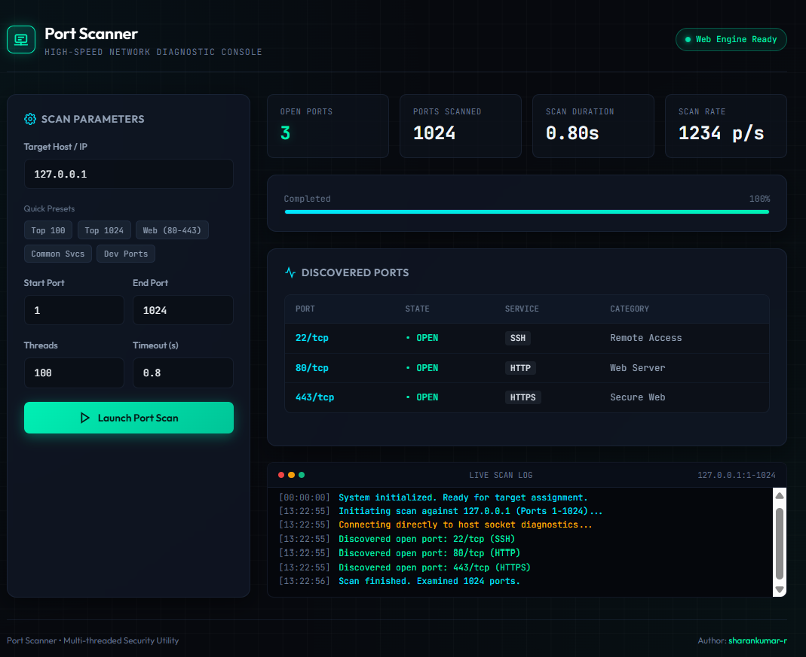

# Port Scanner

A fast, lightweight, and modern multi-threaded TCP port scanner written in Python with an interactive Web Security Dashboard.



## Features
- **High-Speed Multi-Threading**: Uses `concurrent.futures.ThreadPoolExecutor` for fast concurrent port scanning.
- **Interactive Web Dashboard**: Cyber-themed visual UI (`index.html`) with real-time logs, metrics, presets, and results table.
- **Zero External Dependencies**: Pure Python standard library (`socket`, `http.server`, `argparse`).
- **Service Name Lookup**: Identifies common TCP services (HTTP, SSH, MySQL, Redis, etc.).
- **Flexible Modes**: Run via CLI flags, interactive terminal prompt, or browser GUI.

---

## How to Run

### 1. Web Dashboard (Visual UI)
Launch the built-in local web server:
```bash
python port_scanner.py --web
```
Open **[http://localhost:8080](http://localhost:8080)** in your browser.

> **Tip:** You can also directly double-click or open `index.html` in any web browser to view and test the UI.

---

### 2. Command Line Interface (CLI)
Scan with custom targets and port ranges:
```bash
# Scan common ports (1-1024)
python port_scanner.py -t 127.0.0.1

# Scan custom port range
python port_scanner.py -t scanme.nmap.org -p 20-100

# Specify worker threads and timeout
python port_scanner.py -t example.com -p 1-1000 -w 150 --timeout 0.5
```

---

### 3. Interactive CLI Mode
Run without arguments and follow the prompt:
```bash
python port_scanner.py
```

---

## Repository
- **GitHub**: [https://github.com/sharankumar-r/port-scanner](https://github.com/sharankumar-r/port-scanner)
- **Author**: [sharankumar-r](https://github.com/sharankumar-r)
